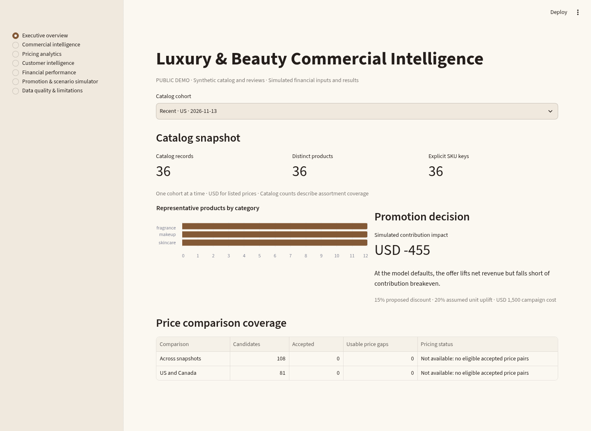
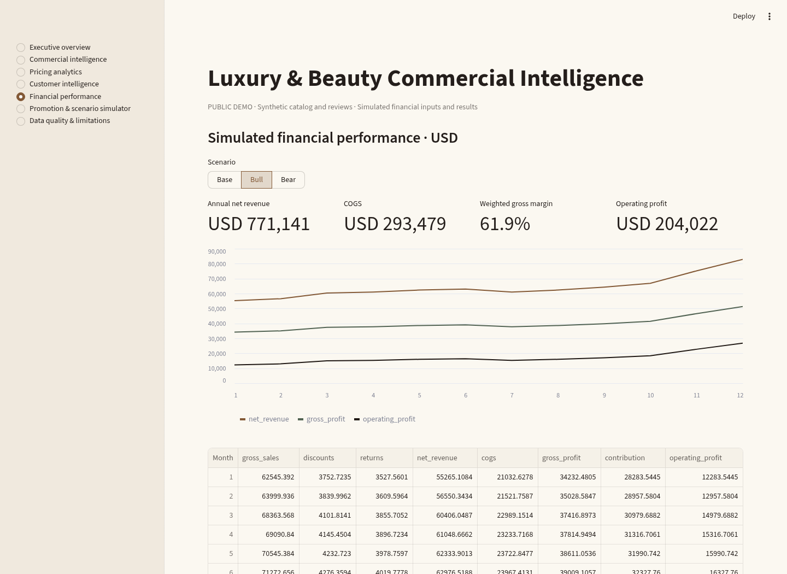
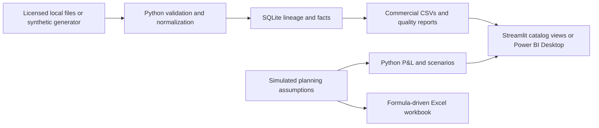

# Luxury & Beauty Commercial Intelligence Platform

**Version 1.0 · Retail assortment, pricing, and commercial finance**

A retailer can see what is listed, priced, or reviewed in a catalog without knowing what sold. This project keeps those signals separate from a simulated P&L so a commercial team can assess assortment and pricing, then test whether a promotion justifies its campaign spend.

| Business question | Deliverable |
|---|---|
| What is represented in the catalog? | Product/SKU counts, brand and category coverage, review topics, and field-level quality |
| Where does the assortment sit on the price ladder? | Native-currency category tiers, brand positioning, eligible discount depth, and auditable match evidence |
| Is a campaign worth funding? | Formula-driven Excel P&L, budget variance, SKU and channel profitability, and interactive promotion breakeven |
| How can stakeholders reproduce it? | Python and SQLite pipeline, Streamlit public demo, and a Power BI Desktop implementation kit |

## Dashboard previews

Screenshots captured from the running Streamlit app. Catalog data are synthetic and all financial inputs and outputs are simulated.

[](assets/streamlit-commercial-demo.png)

[](assets/streamlit-finance-demo.png)

## Architecture


## Windows and PyCharm

Open the repository folder in PyCharm. Use PowerShell in the project root and select `.venv\Scripts\python.exe` as the project interpreter.

```powershell
py -3.12 -m venv .venv
.\.venv\Scripts\python.exe -m pip install -r requirements.txt
.\.venv\Scripts\python.exe -m pytest -q
.\.venv\Scripts\python.exe -m beauty.workbook
.\.venv\Scripts\python.exe -m beauty.demo
.\.venv\Scripts\python.exe -m streamlit run app.py
```

Open the [15-sheet Excel workbook](models/excel/Luxury_Beauty_Commercial_Financial_Model.xlsx), choose Base, Bull, or Bear, and recalculate with **F9** in Excel. Read the [illustrative financial case](reports/illustrative-financial-case.md) for a worked planning decision.

## Run with licensed source files

Place the licensed archives in the ignored `data/raw/` folder. The pipeline reads ZIP members directly and also accepts extracted directories. The default configuration selects `sephora_sample_2026-11-13.csv` and maps its reported columns. The diagnostic prints aggregate counts and ranges for local review.

```powershell
$python = '.\.venv\Scripts\python.exe'
$recent = 'data/raw/sephora-sample-2026-11.zip'
& $python -m beauty.pipeline --diagnose $recent
& $python -m beauty.pipeline --historical 'data/raw/archive (1).zip' --recent $recent --benchmark 'data/external/benchmark_template.csv'
```

If you already have `config/sources.local.json`, refresh its recent schema from the tracked configuration and keep your verified historical, FX, and CPI settings:

```powershell
$defaults = Get-Content 'config/sources.json' -Raw | ConvertFrom-Json
$localPath = 'config/sources.local.json'
if (Test-Path $localPath) {
    $local = Get-Content $localPath -Raw | ConvertFrom-Json
    $local | Add-Member -NotePropertyName recent -NotePropertyValue $defaults.recent -Force
    $local | ConvertTo-Json -Depth 20 | Set-Content $localPath -Encoding UTF8
} else {
    Copy-Item 'config/sources.json' $localPath
}
& $python -m beauty.pipeline --diagnose $recent --config $localPath
& $python -m beauty.pipeline --historical 'data/raw/archive (1).zip' --recent $recent --config $localPath --benchmark 'data/external/benchmark_template.csv'
```

The recent snapshot date comes from the date in each ISO collection timestamp, retaining its supplied offset when present. Missing or invalid recent timestamps leave the snapshot date blank. Size, subcategory, observed promotion, and stockout are unavailable in the reported schema. Verify price definitions, actual value distributions, and dates locally before interpreting the results. Keep raw data, diagnostics saved under `output/`, and `data/processed/` local. Import exports following the [Power BI Desktop guide](dashboard/powerbi/README.md).

## Methodology and portfolio

- [Architecture, data model, governance and KPI dictionary](docs/methodology.md)
- [Financial model formula guide](docs/finance.md)
- [SQL query library](sql/analysis.sql)
- [Executive strategy report template](reports/executive-strategy-template.md)
- [Learning and interview guide](docs/interviews.md)
- [Portfolio copy and verification checklist](docs/portfolio.md)

The checkout contains synthetic test fixtures and simulated retailer planning assumptions. Real-source acquisition, licensing, date and schema checks, benchmark verification, and Power BI Desktop publication belong to the observed-data validation workflow. Sephora, LVMH, and Cartpie have no affiliation with this case study.

## Release validation

Start with `quality_completeness.csv`, `quality_report.csv`, `assortment_counts.csv`, and `comparison_coverage.csv`. Those tables distinguish source records, usable field coverage, distinct items, and comparable price pairs. Use the [external reference guide](docs/external-references.md) to add reviewed FX, CPI and industry inputs and the [executive brief](reports/portfolio-executive-brief.md) for the publication checklist. The project owner's earlier Windows run confirmed licensed-archive ingestion on the prior schema release. The current audit changes use synthetic regression data.

## Evidence and publication

The owner’s Windows validation of the preceding release passed 22 tests and processed both licensed archives. The Version 1.0 suite covers the synthetic generator, dashboard navigation and native-currency switching alongside pipeline and finance regressions. The workbook uses simulated assumptions, and catalog coverage measures presence in the sourced sample. Cross-market and longitudinal price gaps are unavailable on the supplied archive validation. Confidence labels do not certify product specifications.

The public Streamlit startup uses fictional records only. To explore private outputs on your own machine, set `$env:BEAUTY_LOCAL_CATALOG_DIR = (Resolve-Path 'data/processed').Path` and launch Streamlit with `--server.address 127.0.0.1`. Before running a public demo, clear that variable with `Remove-Item Env:BEAUTY_LOCAL_CATALOG_DIR -ErrorAction SilentlyContinue`. Keep licensed raw files, derived exports, private databases and local configuration out of the repo and release assets.

The [release checklist](docs/release-checklist.md) covers the final Windows check, Desktop workflow, and GitHub release review.
