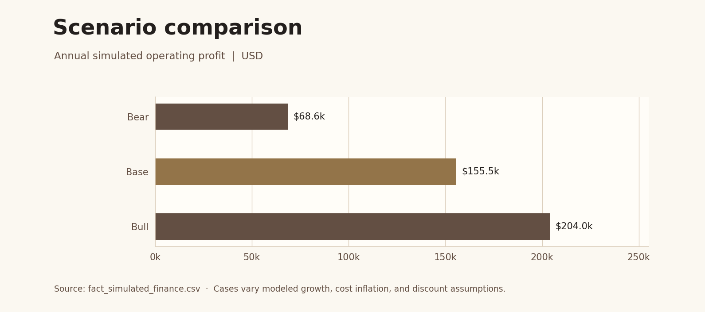
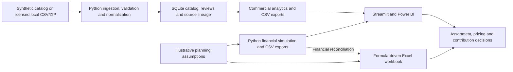

# Luxury & Beauty Commercial Intelligence Platform

**Advanced Commercial Decision Intelligence** · Independent portfolio case in commercial analytics, FP&A, merchandising, and business intelligence.

[](https://luxury-beauty-commercial-intelligence.streamlit.app/)

## Professional Portfolio

Explore the integrated commercial intelligence portfolio, combining commercial strategy, financial modeling, business intelligence, and data-driven decision-making.

| Portfolio | Focus |
|---|---|
| [Integrated Work Sample](portfolio/v3/Commercial_Business_Analytics_Integrated_Work_Sample.pdf) | Commercial strategy, pricing, profitability, and decision support |
| [Commercial & Business Analytics](portfolio/v3/Commercial_Business_Analytics_Flagship_V3.pdf) | Commercial performance and strategic analysis |
| [Finance & FP&A](portfolio/v3/Finance_FPA_Portfolio_V3.pdf) | Financial modeling, variance analysis, and scenario planning |
| [Business Analytics & BI](portfolio/v3/Business_Analytics_BI_Portfolio_V3.pdf) | SQL, Power BI, Python, and analytical reporting |
| [Executive Decision Brief](portfolio/v3/Commercial_Executive_Brief.pdf) | Key findings and actionable recommendations |

[](portfolio/v3/README.md)
[](portfolio/v3/Recruiter_Portfolio_V3_FINAL.zip)

--- 

A beauty retailer can see which products are listed, what they cost, and what customers review. Those signals can guide an assortment or pricing review. Funding a promotion also requires a view of unit response, costs, returns, and contribution. This project gives commercial, merchandising, and finance teams separate evidence for those decisions.

| Explore | What you’ll find |
|---|---|
| [Live Streamlit dashboard](https://luxury-beauty-commercial-intelligence.streamlit.app/) | Browser-based public demo with synthetic catalog data, scenario selection, and promotion decision support. |
| [Power BI Desktop report](dashboard/powerbi/README.md) | Native ten-page report with an optimized project and independent fallback. |
| [Excel financial model](models/excel/Luxury_Beauty_Commercial_Financial_Model.xlsx) | Editable scenario assumptions, formula-driven P&L, and reconciliation checks. |
| [GitHub source code](https://github.com/ericashieh0308-creator/Luxury-Beauty-Commercial-Intelligence) · [v1.0.0 release](https://github.com/ericashieh0308-creator/Luxury-Beauty-Commercial-Intelligence/releases/tag/v1.0.0) | Python and SQL source, demo generator, tests, and the versioned release. |

[Executive summary](docs/executive-summary.md) · [Visual portfolio](assets/portfolio/README.md)

## Executive highlights

- **Commercial intelligence.** Analyze product and SKU coverage, brand and category positioning, eligible discounts, and historical review signals. Scope price metrics by currency and surface insufficient evidence for price comparisons.
- **Financial planning.** Reconcile a 12-month P&L, Base/Bull/Bear forecasts, budget variance, SKU and channel contribution, and a price–volume–mix bridge.
- **Promotion decision.** A simulated 15% discount with 20% unit uplift raises net revenue by **USD 6,110** but lowers contribution by **USD 455**. At those assumptions, campaign ROI is **−30.3%** and contribution break-even requires **1,219 whole units**.
- **Power BI delivery.** The optimized project has **10 pages, 76 visuals, 28 model tables, and 32 DAX measures**. The owner reported a successful Windows Desktop open and refresh, access to all ten pages, and matching Base results.

The public catalog and reviews are synthetic. All financial inputs and results are simulated. The project has no affiliation with or endorsement from any retailer or brand.

## Dashboard previews

[](assets/streamlit-commercial-demo.png)

*Screenshot captured from the running Streamlit demo. The [visual portfolio](assets/portfolio/README.md) includes a finance screenshot and five charts generated from public demo exports.*

[](assets/portfolio/scenario-comparison.png)

*Generated comparison chart sourced from the finance CSV export.*

## Business questions and methods

| Decision | Evidence and method |
|---|---|
| Where should we review assortment? | Scope source records, distinct products, and product–SKU keys by market and snapshot. Use brand and category ranks to prioritize follow-up. |
| Where does an item sit on the price ladder? | Use native-currency list prices, category-relative tiers, and eligible discount depth. Use known-value denominators for merchandising flags. |
| What feedback warrants qualitative review? | Summarize historical ratings and lexicon-based topics. Track missing review text and invalid ratings. |
| Can we compare prices across markets or years? | Separate candidates from accepted pairs and usable gaps. Require comparable products and eligible prices, plus dated FX or CPI where applicable. |
| How does performance change under a different plan? | Compare a simulated P&L, Base budget versus Bull simulated actual, scenario forecasts, and price–volume–mix effects. |
| Is a SKU, channel, or offer worth further investment? | Evaluate modeled contribution, promotion ROI, and break-even units under explicit assumptions. |
| Which results should we trust? | Review source lineage, completeness, parse validity, and quality exceptions before interpreting KPIs. |

## System architecture



**Technology stack:** Python, SQL, SQLite, Excel, openpyxl, Power BI, Power Query, DAX, PBIR, TMDL, Streamlit, Git, and GitHub.

## Financial intelligence

The simulated P&L builds revenue from modeled units, prices, discounts, and returns, then applies COGS, variable expenses, and fixed costs. Gross and operating margins divide aggregate profit by aggregate revenue. The fixed Base-versus-Bull budget view and price–volume–mix bridge complement the selectable forecast. SKU and channel models use their own contribution drivers. The promotion grid varies the proposed discount and unit response.

| Simulated annual scenario | Net revenue | Operating profit | Gross margin | Operating margin |
|---|---:|---:|---:|---:|
| Bear | USD 586,266.43 | USD 68,603.88 | 55.6% | 11.7% |
| Base | USD 700,824.23 | USD 155,492.93 | 60.3% | 22.2% |
| Bull | USD 771,141.05 | USD 204,021.55 | 61.9% | 26.5% |

See the [finance methodology](docs/finance.md) and [illustrative decision brief](reports/illustrative-financial-case.md) for formulas and reconciliation.

### Excel workbook

The [15-sheet workbook](models/excel/Luxury_Beauty_Commercial_Financial_Model.xlsx) includes editable scenario controls and drivers, product economics, monthly P&L, budget variance, forecast, channel profitability, promotion ROI, price–volume–mix, sensitivity analysis, an executive view, and model checks. Choose a case on **01_Control_Panel**, review **02_Assumptions**, press **F9**, and confirm the five checks on **14_Model_Checks**.

## Power BI dashboard

| Report page | Purpose |
|---|---|
| Executive Overview | Review source coverage before drawing conclusions. |
| Market & Assortment Intelligence | Compare catalog cohorts and distinguish records from distinct items. |
| Brand & Category Performance | Rank assortment representation and review known merchandising flags. |
| Pricing & Promotional Intelligence | Compare native-currency price positioning and eligible discount depth. |
| Customer Reviews & Product Intelligence | Explore historical ratings and topic mentions with coverage caveats. |
| Cross-Market & Historical Comparison | Monitor match queues and distinguish usable gaps from unavailable results. |
| Financial Performance & P&L | Trace simulated monthly revenue, cost, contribution, and operating profit. |
| Budget Variance & Scenario Forecasting | Compare forecasts and interpret fixed Base-versus-Bull variance and PVM. |
| SKU, Channel & Promotion Profitability | Test contribution drivers, promotion ROI, and break-even hurdles. |
| Data Quality & Methodology | Review completeness, severity, and analytical limitations. |

The [optimized and fallback candidates](dashboard/powerbi/release-candidates.md) open in separate local sessions. The launcher generates synthetic inputs and sets the local `DemoRoot`. A local PBIX is outside the repository.

## Quick start · Windows PowerShell

From the repository root, set up Python 3.12 and validate the public demo:

```powershell
py -3.12 -m venv .venv
$python = '.\.venv\Scripts\python.exe'
& $python -m pip install -r requirements.txt
& $python -m pytest -q
& $python -m beauty.demo
& $python -m scripts.validate_powerbi
```

**Streamlit, local setup.** Explore assortment and review evidence, change operating assumptions, compare scenarios, and test promotion sensitivity in the local browser.

```powershell
Remove-Item Env:BEAUTY_LOCAL_CATALOG_DIR -ErrorAction SilentlyContinue
& $python -m streamlit run app.py --server.address 127.0.0.1
```

**Power BI.** Run either command with Power BI Desktop installed, then refresh the prepared project.

```powershell
& .\scripts\open-powerbi.ps1 -Candidate optimized
# If needed, launch the independent fallback
& .\scripts\open-powerbi.ps1 -Candidate fallback
```

## Data governance and limitations

The pipeline supports licensed local catalog and review archives. It tracks source hashes and row lineage, validates schema and currency, records invalid and missing values, and keeps match candidates separate from accepted pairs. The public workflow generates fictional inputs. Private files, derived outputs, local configuration, and caches stay outside Git. See the [source and KPI methodology](docs/methodology.md) and [external reference guide](docs/external-references.md).

- Catalog records describe sample coverage. Review signals and merchandising flags cannot establish sales, market share, or causal customer behavior.
- The public demo has no usable cross-market or historical price gaps. It reports unavailable comparisons explicitly. No verified industry benchmarks, FX, or CPI values are included in the public demo.
- Python tests, structural checks, and Microsoft TOM deserialization provide independent validation. Windows Power BI opening, refresh, and visual results are **user-reported**. Power BI Desktop screenshots and the local PBIX are outside the repository.

## Repository guide and skills demonstrated

```text
beauty/            Ingestion, SQLite analytics, synthetic demo, and finance
sql/               Schema, quality views, and analytical SQL
models/excel/      Formula-driven financial workbook
dashboard/powerbi/ Native report, semantic model, and stability fallback
app.py             Interactive Streamlit dashboard and decision simulator
assets/portfolio/  Generated figures and preview index
docs/              Methodology, executive summary, and career materials
scripts/           Power BI preparation and validation
tests/             Pipeline, finance, dashboard, and release regression tests
```

Demonstrates commercial and merchandising analysis, financial modeling and FP&A, business intelligence, Python and SQL data engineering, Excel and Power BI reporting, scenario analysis, and analytical governance.

[Career and interview materials](docs/career-portfolio.md) · [GitHub publication checklist](docs/github-publication.md)
