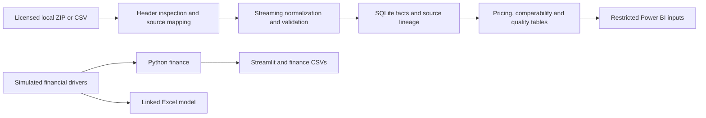
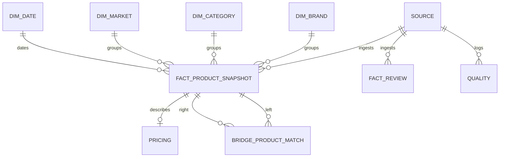

# Evidence, data model and KPI definitions

## Source registry

| Source | Intended evidence | Status |
|---|---|---|
| [Kaggle historical catalog and reviews](https://www.kaggle.com/datasets/nadyinky/sephora-products-and-skincare-reviews) | US product list prices, flags and historical reviews | Archive, dates and applicable license require verification |
| [Cartpie sample](https://cartpie.com/datasets/sephora/sample) | Recent US and CA list prices and available SKU/attribute fields | Archive schema, collection dates, sampling and redistribution terms require verification |
| [Federal Reserve H.10](https://www.federalreserve.gov/releases/h10/) | Dated USD per CAD after converting quoted convention if needed | Candidate source. Record rate, date, quotation convention and link before use |
| [BLS CPI](https://www.bls.gov/cpi/) | Monthly US CPI index with consistent series and base | Candidate source. Verify series and data vintages |
| Circana, SEC filings, LVMH and L'Oréal releases | Industry context | The benchmark registry template starts empty. The cloud proxy denied access to Circana, BLS and SEC during setup. Enter verified observations with measurement definitions.|

The [benchmark template](../data/external/benchmark_template.csv) validates exact headers, completeness, dates, finite numbers and HTTPS source links. Validation of metric meaning and provenance remains manual. In a local config use `fx_usd_per_cad` as an ISO-date-to-rate map and `cpi_us` as a YYYY-MM-to-index map. Keep verified FX/CPI citations with the benchmark registry. FX selection uses the snapshot day or latest supplied observation up to four calendar days earlier. Supply official business-day observations only.

## ERD and data dictionary

| Entity | Grain and fields |
|---|---|
| source | One file member. Vintage, member path, SHA-256 and header JSON |
| fact_product_snapshot | One input record with lineage `source_id,line`. Local market, currency, snapshot, native product/SKU, category, size, variant, list/sale price, rating, engagement and nullable binary flags |
| fact_sku_snapshot | Product snapshot view restricted to records with SKU IDs |
| dim_brand/category/market/date | Normalized brand/category, two market/currency codes, or distinct nonempty snapshot date |
| dim_product | Distinct market/product/brand/name attributes. Use source and date when resolving changing labels |
| fact_review | One historical review record. Product, date, rating, sentiment; excludes text and reviewer ID |
| review_summary / review_topic | Product review aggregates and counts per product/topic |
| pricing / product_position | Eligible representative product price tier, category gap, discount depth, positioning score, rating and engagement |
| price_comparison | One eligible accepted pair. Native and USD list prices, gaps, FX date, stress bounds, CPI change, tier and promotion fields |
| bridge_product_match | Candidate pairs by endpoint IDs and comparison; method and status |
| commercial_kpi / portfolio | Cohort aggregates, including explicit flag denominators and product selection rules |
| category_diagnostics / sku_portfolio | Category-level price relationship and concentration metrics, and distinct SKU counts and price ranges |
| quality_report / duplicate_keys | Field exceptions by file and cross-file product/SKU duplicate keys |
| fact_industry_benchmark | Contextual statistic with organization, dated period, geography, metric, value, units, URL, retrieval date and limitations |
| finance_assumptions / fact_simulated_finance | Separate finance CSVs with simulation labels; driver or scenario-month grain |

## Quality and interpretation

Read `quality_report.csv` and `duplicate_keys.csv` before using any KPI. Text normalization is Unicode NFKC, case-folding and space collapse for brand, category, size and variant. It intentionally preserves size units. Missing values remain null, invalid values are logged and nulled, unidentified rows are excluded and counted, suspicious nonnegative prices are retained and flagged. Duplicate rows remain in the snapshot fact. Source row ordinal uses CSV record order. Prices outside expected currencies are excluded from comparable pricing. Full review text stays in raw archives. The pipeline streams review rows in 5,000-record writes.

| KPI | Definition and interpretation |
|---|---|
| Products | One explicit parent per source vintage–market–date–product where unique. A single SKU can serve as a product representative. Ambiguous and variants-only multisets stay in SKU analysis |
| Brands and SKUs | Distinct known brand within the cohort. SKU volume counts distinct product/SKU identities, never units sold |
| Assortment share | Segment products divided by selected cohort products. It describes catalog composition |
| Mean/median and range | Positive list prices among expected-currency representative products |
| Price tier | Inclusive category quartiles computed within market, vintage and snapshot. Ties remain in the lower band. At least four eligible products are required |
| Concentration | Brand Herfindahl index among eligible priced products with known brands |
| Rating and engagement | Mean known rating and sum of known catalog engagement counts, with coverage. Engagement is a historical platform signal |
| Flag shares | True records divided by known true or false values for that flag. Snapshot availability reflects a point-in-time observation |
| Discount depth | One minus sale divided by list, where list is positive and sale is no higher than list |
| Premium proxy | Midrank percentile of category list price × 0.8 plus exclusive flag × 0.2, on a 0–100 scale. Sensitivity weights are 0.95 / 0.05. Unknown exclusivity leaves the score blank |
| Price relationships | Pearson association with rating and engagement, with complete-pair count. Constant or fewer than three pairs yield a blank |

The lexicon baseline counts positive minus negative term presence. Zero represents neutral or unscored language. Topic counts support qualitative triage. Before reporting sentiment rates, have a second reviewer independently label a permitted local sample. Record criterion, agreement, precision/recall, negation errors and neutral-class coverage. Historical review findings only describe the historical review pool.

## Cartpie November 2026 mapping

The mapping selects the reported `sephora_sample_2026-11-13.csv` member. Run `python -m beauty.pipeline --diagnose <archive>` locally to review raw country, currency and flag counts, normalized markets and dates, numerical ranges and validation issues. The timestamp uses its source calendar day for snapshot grouping, retaining its offset when provided. Country codes and names map to US or CA. A conflicting code and name retains the row under an unknown market. USD/CAD is checked independently against market.

The pipeline stores `price` as the reported base price, `price_max` as the reported upper endpoint, and `sale_price` as the reported sale field. Numeric values must be finite and nonnegative. An upper bound below base or a sale above base is retained and logged for review. Pricing summaries exclude reversed ranges and use the reported base for valid ranges. Price-pair comparisons and discount-depth calculations require a point price (equal endpoints or no reported maximum). Confirm these source definitions locally before interpreting the pricing results. Cartpie promotion stays blank even when a lower sale price is reported.

Product and explicit SKU rows retain their source identities. `variant_count`, `variant_sku_ids` and `variation_type` are descriptive inputs. They do not generate SKU rows or populate the verified size or variant fields. Subcategory and availability also stay blank. A recent row without verified size remains in the manual-review pool when a name or identifier provides a match candidate.

## Product comparison

Candidates are blocked by normalized brand. Auto-acceptance requires reciprocal uniqueness within the paired snapshot, exact normalized brand/name/size/variant and known dates. Comparable identifiers can identify exact SKU or exact product-plus-variant matches. Declare `identifier_scopes.cross_market.evidence` or `identifier_scopes.longitudinal.evidence` only after confirming that comparison scope. Shared IDs surface candidates but cannot override contradictory or unavailable specifications. Missing SKU variants and fuzzy name matches go to manual review. Review packaging, reformulation, units and list-price semantics before interpreting accepted pairs. Cross-market comparisons require the same snapshot day and correct local currency. Report accepted and eligible pair counts, source denominators, directional gaps and coverage by category. Missing sample items have unknown disposition. Sample selection, survival and matched-product coverage limit generalization.

Nominal difference is right USD list minus left USD list. Relative gap divides that difference by left list. Longitudinal CPI change is right/left price ratio multiplied by old/new CPI minus one. Tier migration can be evaluated at fixed left-snapshot thresholds. US/Canada FX stress applies ±5% to the supplied USD-per-CAD rate. Taxes, import costs, fulfillment and regional positioning are possible explanatory hypotheses requiring evidence.

## Audit outputs and coverage

- `quality_completeness` reports evaluated rows, present values and parse-valid values by source member and field. Rows excluded before field evaluation are counted in the source-level issue report. The issue denominator is the field evaluation denominator when available and the source row count for cross-field rules. Parse validity measures type and range checks, while semantic exceptions are reported separately. `quality_raw_value` remains in the local database and preserves original catalog ratings and prices plus failed scalar inputs by file and row. Review text is excluded. A zero or other out-of-range rating can be a possible sentinel and requires provider confirmation.
- `assortment_counts` reports physical retained records, distinct products, rows carrying SKU IDs and distinct product/SKU keys. Representative-product KPIs additionally exclude unresolved product groups. These counts describe source coverage.
- `bridge_product_match` records ID equality, normalized-name similarity, verified matching size and variant, and declared scope evidence. Candidate classes are exact, high confidence, ambiguous, manual review, and rejected. Only mutually unique, verified pairs enter pricing eligibility. Distinct SKU/product grains cannot auto-match each other.
- `comparison_coverage` reports source and candidate endpoint denominators, accepted shares, priced pairs, and usable gaps. `match_coverage` breaks candidate pairs down by status, method, confidence and reason. The same source row can enter several candidate groups, so group endpoint counts are not additive. Longitudinal coverage is the intersection of defensibly comparable records from two sampled catalogs. It cannot establish assortment growth, retailer inflation, or the proportion of all listings with higher prices.
